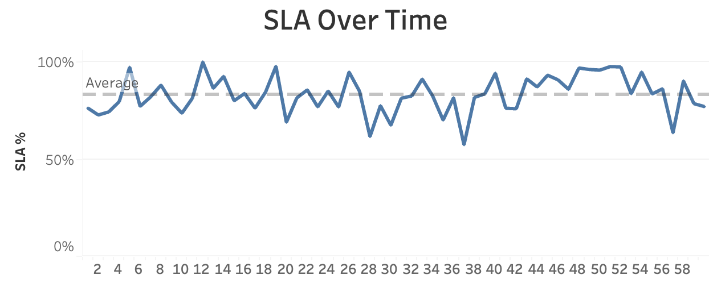
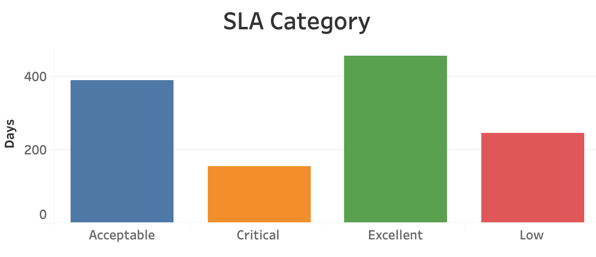
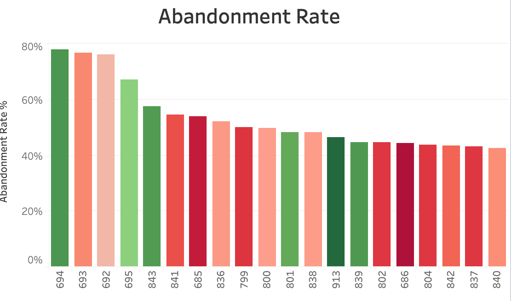
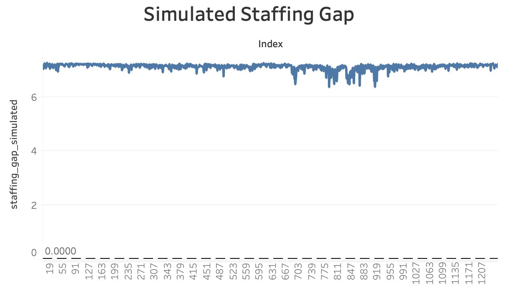

# Call Center Workforce Management Analytics

A data analytics project focused on **call-center workforce planning, service-level performance, customer waiting time, abandonment, and staffing requirements**. The project uses **Google BigQuery (SQL)** for data preparation and analytical modeling, with **Tableau Public** for KPI visualization and operational insights.

> **Project Type:** Data Analytics & Business Intelligence  
> **Tools:** Google BigQuery, SQL, Tableau Public  
> **Focus:** Workforce Optimization, SLA Monitoring, Abandonment Analysis, Staffing Simulation

---

## 📌 Project Overview

Call centers need to balance customer demand with available agents. Understaffing can increase waiting time and abandonment, while excessive staffing can increase operating costs.

This project analyzes historical call-center performance to answer practical workforce-management questions such as:

- How is **Service Level (SLA)** changing over time?
- Which days experience poor service performance?
- How does **waiting time** relate to customer abandonment?
- Which periods have the highest operational workload?
- How many agents may be required based on workload?
- What happens to service performance under increased demand?
- Where can workforce planning be improved?

The analysis combines operational KPIs with derived metrics and staffing simulations to support data-driven workforce decisions.

---

## 🎯 Business Objectives

### 1. Monitor Service Level
Track daily SLA performance and identify periods where service quality falls below the desired threshold.

### 2. Analyze Customer Abandonment
Measure abandonment rates and investigate their relationship with waiting time and call volume.

### 3. Evaluate Workforce Requirements
Estimate required staffing levels using workload and time-based metrics.

### 4. Identify High-Pressure Periods
Use workload indicators, SLA performance, and waiting-time metrics to identify operationally difficult days.

### 5. Simulate Staffing Scenarios
Evaluate hypothetical staffing and demand scenarios to understand their potential effect on SLA and workforce gaps.

---

## 🗂️ Repository Structure

```text
call-center-wfm-main/
│
├── README.md
├── LICENSE
├── requirements.txt
│
└── screenshots/
    ├── abandonment_rate_colored.png
    ├── kpi_zone.png
    ├── simulated_staffing_gap.png
    ├── sla_category_distribution.png
    └── sla_over_time.png
```

**Note:** The repository currently contains the project documentation and dashboard screenshots. The original raw dataset and BigQuery SQL workspace are not included in this repository.

---

## 🔄 Analysis Workflow

```text
Raw Call-Center Data
        │
        ▼
Data Cleaning & Preparation
        │
        ▼
Google BigQuery
        │
        ├── KPI Calculation
        ├── SLA Analysis
        ├── Abandonment Analysis
        ├── Workload Modeling
        └── Staffing Simulation
        │
        ▼
Tableau Public
        │
        ▼
Operational Dashboard
        │
        ▼
Workforce Management Insights
```

---

## 🧹 Data Preparation

The analytical workflow included:

- Cleaning column names for SQL compatibility
- Standardizing time-based fields into seconds
- Preparing service-level and call-volume metrics
- Calculating abandonment and answer-rate metrics
- Creating workload and staffing-related derived measures
- Categorizing SLA performance
- Preparing data for visualization in Tableau

---

## 📊 Key Metrics

| Metric | Purpose |
|---|---|
| **Service Level (SLA)** | Measures calls answered within the defined service target |
| **Abandonment Rate** | Measures the proportion of callers who leave before being served |
| **Answer Rate** | Tracks the percentage of incoming calls successfully answered |
| **Waiting Time** | Measures customer waiting/delay before service |
| **Incoming Calls** | Represents daily customer demand |
| **Required Agents** | Estimates staffing requirement from workload |
| **Staffing Gap** | Compares estimated workforce requirement with available staffing |
| **Workload Index** | Combines call volume and time-based workload indicators |
| **Rolling SLA** | Smooths daily SLA fluctuations to identify trends |

---

## 📈 Dashboard & Visual Analysis

### Executive KPI Dashboard

Provides a high-level view of the major call-center performance indicators.


### SLA Over Time

Tracks service-level performance across the observation period and helps identify periods of weaker service performance.



### SLA Category Distribution

Groups observations into SLA performance categories to understand the overall distribution of service quality.



### Abandonment Rate Analysis

Visualizes abandonment behavior alongside waiting-time-related operational indicators.



### Simulated Staffing Gap

Examines the potential staffing requirement/gap under a simulated workforce scenario.



---

## 🧮 Analytical Modeling

Several derived metrics were used to move beyond descriptive reporting.

### Workload Index

A custom workload indicator combining call volume with talk and waiting-time measures:

```text
Workload Index =
Incoming Calls × (Talk Duration + Waiting Time)
```

### Required Agents

An approximate staffing requirement was estimated from workload:

```text
Required Agents =
CEILING((Talk Duration + Waiting Time) / Time Capacity)
```

### Staffing Gap

```text
Staffing Gap =
Required Agents − Available Agents
```

### Rolling SLA

A 7-day rolling SLA was used to reduce day-to-day noise and identify broader performance trends.

### Outlier Detection

SLA observations were compared against the mean and standard deviation to flag unusually weak performance periods.

---

## 🔎 Key Findings

The analysis highlighted several operational patterns:

- Average observed **SLA was approximately 70.9%**.
- Average **abandonment rate was approximately 7.3%**.
- Some periods showed substantially higher abandonment and waiting-time pressure.
- Workload-adjusted metrics helped identify operationally difficult periods that may not be obvious from call volume alone.
- Staffing simulations were used to evaluate how additional workforce capacity could potentially improve service performance.
- SLA, waiting time, abandonment, and staffing metrics should be considered together rather than optimizing a single KPI independently.

> **Important:** Simulation results are scenario-based estimates and should not be interpreted as actual staffing recommendations without validating assumptions against real workforce, queueing, and operational constraints.

---

## 🧠 Business Insights

### What the analysis can help a workforce-management team decide

**1. When should staffing be increased?**  
Prioritize periods showing high workload combined with poor SLA and increasing waiting time.

**2. Where should operational problems be investigated?**  
Focus on days with unusually high abandonment, low answer rates, or significant SLA deterioration.

**3. Should staffing decisions rely only on call volume?**  
No. Call volume alone does not capture handling time or waiting pressure. Workload-related metrics provide additional context.

**4. How can simulations support planning?**  
Scenario analysis can estimate the potential effect of additional staffing or increased demand before operational decisions are made.

---

## 🛠️ Technology Stack

- **SQL**
- **Google BigQuery**
- **Tableau Public**
- **Data Cleaning & Transformation**
- **Data Visualization**
- **KPI Analysis**
- **Workforce Analytics**
- **Scenario / Staffing Simulation**

---

## 💼 Skills Demonstrated

This project demonstrates practical experience with:

- SQL-based data analysis
- Data cleaning and transformation
- Aggregations and KPI calculations
- Window functions
- Ranking and trend analysis
- Correlation analysis
- Outlier detection
- Business metric design
- Workforce analytics
- Scenario modeling
- Dashboard-oriented data storytelling
- Translating operational data into business insights

---

## 📁 SQL Analysis

The project analysis was performed using BigQuery SQL, including queries for:

1. Average SLA
2. Average abandonment rate
3. SLA trend analysis
4. SLA category distribution
5. High-abandonment periods
6. Rolling SLA
7. SLA ranking
8. Waiting-time buckets
9. SLA and talk-duration relationship
10. Low answer-rate periods
11. Volume-adjusted performance
12. Workload analysis
13. Agent requirement estimation
14. Staffing-gap analysis
15. SLA outlier detection
16. Staffing scenario simulation
17. Workload ranking
18. SLA efficiency
19. Calls per talk hour
20. SLA failure-rate analysis
21. High-wait / low-abandonment periods

The SQL workspace and source dataset are not currently included in this GitHub repository.

---

## 🚀 How to Reproduce the Analysis

To reproduce or extend this project:

### Step 1 — Prepare the dataset

Obtain the original call-center dataset and upload it to **Google BigQuery**.

### Step 2 — Clean the data

Standardize column names and convert duration/time fields into consistent units.

### Step 3 — Create analytical metrics

Build SLA, abandonment, waiting-time, workload, staffing, and derived performance metrics using SQL.

### Step 4 — Validate the results

Check KPI calculations against the source data and validate assumptions used in staffing simulations.

### Step 5 — Visualize

Connect the prepared BigQuery dataset to **Tableau Public** and recreate the KPI dashboard and analytical views.

---

## 📌 Potential Extensions

The project can be extended into a more advanced workforce-management system by adding:

- **Intraday forecasting** at 15/30-minute intervals
- Call-volume forecasting using **time-series models**
- **Agent occupancy and shrinkage** analysis
- Erlang-C based staffing calculations
- Cost optimization for staffing decisions
- Automated BigQuery pipelines
- Tableau parameter-driven what-if analysis
- Forecast vs. actual workforce performance
- Cloud-based scheduled data refresh

---

## 📷 Project Preview

The repository includes dashboard screenshots demonstrating the analytical outputs and visualization layer.

---

## 👤 Author

**MALOTH SRAVANI**  
Integrated MSC in MATHEMATICS — NIT ROURKELA..
